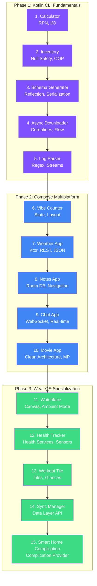

# Kotlin & Wear OS Mastery Curriculum

[](https://kotlinlang.org)
[](https://www.jetbrains.com/lp/compose-multiplatform/)
[](https://gradle.org)
[](https://openjdk.org/projects/jdk/21/)
[-3DDC84?style=flat&logo=android&logoColor=white)](https://developer.android.com/wear)
[](LICENSE)
[](https://github.com/Baldur10/Kotlin101/stargazers)
[](https://github.com/Baldur10/Kotlin101/commits/main)
[](https://github.com/Baldur10/Kotlin101/actions)

Welcome to **Kotlin101**, a progressive **15-project curriculum** designed to take engineers with prior JavaScript/Python experience to advanced Kotlin, Jetpack Compose Multiplatform, and Wear OS development.

---

## Table of Contents
1. [Core Features & Goals](#core-features--goals)
2. [Tech Stack & Tooling](#tech-stack--tooling)
3. [Curriculum Roadmap](#curriculum-roadmap)
4. [Getting Started](#getting-started)
   - [Environment Setup](#1-environment-setup)
   - [Running CLI Projects](#2-running-cli-projects)
   - [Running Compose Desktop Projects](#3-running-compose-desktop-projects)
   - [Running Android/Wear OS Projects](#4-running-androidwear-os-projects)
   - [Running Tests](#5-running-tests)
5. [Architecture Overview](#architecture-overview)
6. [Repository Structure](#repository-structure)
7. [License](#license)

---

## Core Features & Goals
- **Eliminate Type-System Friction:** Specifically designed to help developers from dynamically typed languages (JS/Python) master Kotlin's static typing, null safety, and memory models.
- **TDD (Test-Driven Development) Focus:** Learn to write robust unit, integration, and UI tests before implementing business logic.
- **Declarative UI Mastery:** Zero legacy XML layouts. Every visual module is built using modern Jetpack Compose.
- **Specialized Wear OS Tracks:** Step-by-step guidance through low-level wearable APIs, including Canvas drawing, sensors, Wear OS Tiles, Data Client syncing, and Smart Home complications.
- **Interactive HTML Learning Guides:** Each project comes with its own locally generated interactive `learning-guide.html` covering essential concepts and debugger challenges.

---

## Tech Stack & Tooling

The curriculum utilizes a modern, optimized runtime stack (versions verified across all 15 projects):

### Language & Compiler
| Component | Version | Notes |
| :--- | :--- | :--- |
| **Kotlin** | `2.4.21` | K2 Compiler enabled by default |
| **JDK** | `21` (LTS) | JVM target 21 (`JvmTarget.JVM_21`) |

### Build System & Tooling
| Component | Version | Notes |
| :--- | :--- | :--- |
| **Gradle** | `9.x` | Kotlin DSL (`.gradle.kts`) |
| **Android Studio** | `Ladybug+ / Koala+` | For Android & Wear OS development |
| **Android SDK** | `34` / `Wear OS 4 (API 33)` | System integrations |

### Key Libraries & Frameworks
| Library | Version | Purpose |
| :--- | :--- | :--- |
| **kotlinx.coroutines** | `1.11.0` | Asynchronous flow & structured concurrency |
| **kotlinx.serialization** | `1.12.0` | JSON & binary schema serialization |
| **kotlinx.datetime** | `0.8.0` | Date/time handling (ISO-8601) |
| **Compose Multiplatform** | `1.12.2` | Cross-platform declarative UI |
| **Compose Material3** | `1.12.0-alpha03` | Material Design 3 components |
| **Compose Foundation** | `1.12.2` | Core layout & foundation APIs |
| **Compose Runtime** | `1.12.2` | State & composition runtime |
| **Compose UI** | `1.12.2` | UI toolkit primitives |
| **Navigation Compose** | `2.10.0-rc01` | Type-safe navigation |
| **Material Icons Extended** | `1.7.6` | Extended icon set |
| **Ktor Client** | `3.6.0` | HTTP/WebSocket networking |
| **Mordant** | `3.1.0` | Rich terminal ANSI styling |

---

## Curriculum Roadmap

The course is divided into three progressive phases:

### Phase 1: Kotlin CLI Fundamentals (Projects 1–5)
Focuses on pure Kotlin syntax, object-oriented concepts, functional programming, reflection, generics, and concurrent programming.

| Module | Project | Key Concepts | Directory |
| :--- | :--- | :--- | :--- |
| **1** | [Smart Terminal Calculator](src/1-calculator) | Variables, expression parsing, RPN evaluation, basic I/O | [`src/1-calculator`](src/1-calculator) |
| **2** | [Inventory CLI](src/2-inventory) | Control flow, functions, null safety, OOP paradigms | [`src/2-inventory`](src/2-inventory) |
| **3** | [Schema Generator Integration](src/3-schema) | Reflection, annotations, generics, custom serializers | [`src/3-schema`](src/3-schema) |
| **4** | [Async Downloader](src/4-downloader) | Coroutines, Flow, reactive progress tracking | [`src/4-downloader`](src/4-downloader) |
| **5** | [Log Parser](src/5-logparser) | Regular expressions, string parsing, memory-efficient streams | [`src/5-logparser`](src/5-logparser) |

### Phase 2: Compose Multiplatform & Android (Projects 6–10)
Transitions into cross-platform app engineering using Jetpack Compose, introducing state management, architecture boundaries, and networking.

| Module | Project | Key Concepts | Directory |
| :--- | :--- | :--- | :--- |
| **6** | [Vibe Counter](src/6-vibe-counter) | Compose basic state, state hoisting, layout structures | [`src/6-vibe-counter`](src/6-vibe-counter) |
| **7** | [Weather App](src/7-weather) | REST API (Ktor), JSON parsing, UI state mapping | [`src/7-weather`](src/7-weather) |
| **8** | [Notes App](src/8-notes) | Local persistent storage, lists, single-activity navigation | [`src/8-notes`](src/8-notes) |
| **9** | [Chat App](src/9-chat) | WebSocket client, reactive UI flows, input handling | [`src/9-chat`](src/9-chat) |
| **10** | [Movie App](src/10-movies) | Clean Architecture (Domain/Data/UI), Compose Multiplatform | [`src/10-movies`](src/10-movies) |

### Phase 3: Wear OS Specialization (Projects 11–15)
Focuses on wearable form factors, covering Canvas rendering, hardware sensors, system integrations, and device communication.

| Module | Project | Key Concepts | Directory |
| :--- | :--- | :--- | :--- |
| **11** | [Watchface](src/11-watchface) | Canvas Watch Face Service, Ambient mode, custom drawings | [`src/11-watchface`](src/11-watchface) |
| **12** | [Health Tracker](src/12-health) | Wear OS Health Services, step counter, heart rate sensors | [`src/12-health`](src/12-health) |
| **13** | [Workout Tile](src/13-tile) | Custom layout Tiles, periodic background updates, glances | [`src/13-tile`](src/13-tile) |
| **14** | [Sync Manager](src/14-sync) | Wearable Data Layer API (Data/Message/Node Client) | [`src/14-sync`](src/14-sync) |
| **15** | [Smart Home Complication](src/15-complication) | Complication Provider Service, update cycles, smart home widgets | [`src/15-complication`](src/15-complication) |

---

## Getting Started

### 1. Environment Setup
Verify that your system meets the hardware and software prerequisites by running the automated check script:
```bash
chmod +x src/0-environment/sdk_check.sh
./src/0-environment/sdk_check.sh
```
Make sure to enable **Kotlin K2 Mode** in Android Studio under **Settings → Languages & Frameworks → Kotlin**.

### 2. Running CLI Projects
For Phase 1 projects (1 to 5), build and run directly from the command line:
```bash
cd src/1-calculator
./gradlew run
```

### 3. Running Compose Desktop Projects
For Compose Desktop projects (6, 10), run the desktop target:
```bash
cd src/6-vibe-counter
./gradlew run
```

### 4. Running Android & Wear OS Projects
For Phase 2 and 3 projects (7–15):
1. Launch **Android Studio**.
2. Open the project folder (e.g., `src/10-movies` or `src/11-watchface`).
3. Set up an Android Virtual Device (AVD) or Wear OS Emulator in the device manager.
4. Click **Run** (`Ctrl+R` / `Cmd+R`).

### 5. Running Tests
The curriculum enforces a **TDD-First** approach. Execute unit and integration tests for any project:
```bash
cd src/1-calculator
./gradlew test
```
For all projects:
```bash
./gradlew test --parallel
```

---

## Architecture Overview



---

## Repository Structure

```
.
├── LICENSE
├── README.md                 # This guide
├── docs/                     # Course administration & design records
│   ├── architecture.md       # Architecture guidelines
│   ├── current_state.md      # Active repository state and runtime variables
│   ├── decision_log.md       # Chronological ADR-style logs
│   ├── handoff.md            # Actionable status records between sessions
│   ├── project_brief.md      # Curriculum constraints & user profiles
│   └── setup_guide.md        # Detailed IDE configurations
├── src/                      # Source projects (1 to 15)
│   ├── 0-environment/        # Environment verification scripts
│   ├── 1-calculator/
│   │   ├── src/              # App source code and tests
│   │   ├── build.gradle.kts  # Gradle configuration
│   │   └── learning-guide.html # Interactive HTML guide
│   └── ...
└── tests/                    # Shared testing utilities and resources
```

---

## Quick-Start Commands Reference

| Action | Command | Works For |
| :--- | :--- | :--- |
| **Verify Environment** | `./src/0-environment/sdk_check.sh` | All projects |
| **Run CLI Project** | `cd src/1-calculator && ./gradlew run` | Projects 1–5 |
| **Run Compose Desktop** | `cd src/6-vibe-counter && ./gradlew run` | Projects 6, 10 |
| **Run Tests (Single)** | `cd src/1-calculator && ./gradlew test` | Any project |
| **Run Tests (All)** | `./gradlew test --parallel` | All projects |
| **Build All** | `./gradlew build --parallel` | All projects |
| **Clean Build** | `./gradlew clean build --parallel` | All projects |
| **Open in Android Studio** | `open -a "Android Studio" src/11-watchface` | Projects 7–15 |

---

## Guiding Principles

- **TDD (Test-Driven Development) first:** Always run/inspect the existing test cases in the `src/<project>/src/test` directory before making logic modifications.
- **Clean Architecture:** From Project 10 onward, maintain strict boundaries between layers:
  - **Domain:** Pure Kotlin models, UseCases, and Repository interfaces.
  - **Data:** Repository implementations, network requests (Ktor), and local databases.
  - **UI:** ViewModels, Compose screens, and State wrappers.
- **Aesthetics & UX:** UI modules should have rich modern aesthetics (glassmorphism, tailored HSL color palettes, responsive layouts).
- **Self-contained Learning:** Open `learning-guide.html` in your web browser inside any project folder to read detailed concept breakdowns and debugging exercises.

---

## License

This project is open-source software licensed under the **Apache License 2.0**. See the [LICENSE](LICENSE) file for details.

Copyright 2026 Rahil Mohan